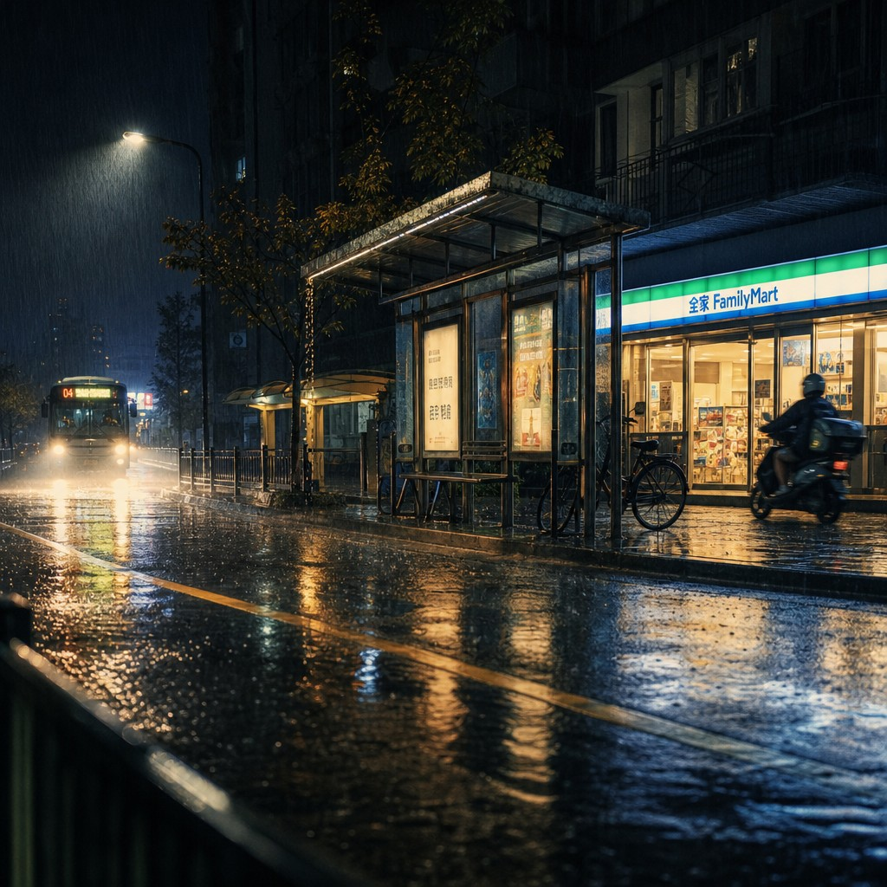

# 雨夜公交站 · 环境声设计

> 2026 SHU 基础实践 · 期末作业
> 场景：深秋雨夜，学校附近街角的末班公交站。
> 单文件提交说明：[`提交说明.md`](提交说明.md)



*场景概念图（AIGC 生成，仅用于说明空间关系；最终音频资产未使用 AIGC）。*

## 场景

深秋的上海，晚上十点半，一场持续的冷雨。街角的公交站只剩一盏广告灯箱亮着，站台顶棚把雨切成两种声音：头顶密集的敲击，和檐口成串滴落的水珠。马路上偶有车辆碾过积水，轮胎带起一片水雾；远处高架的车流像一条低沉的河。站牌后的全家便利店自动门开合，传出短暂的提示音。等末班车的人把伞收拢，跺掉鞋上的水，站台顶棚下的回声让每一次动作都显得很近。

听者站在站台顶棚下，背对广告灯箱，面向马路。头顶是近场雨打顶棚，外面是中远场雨打路面和车流，两种雨声天然分层。

更详细的空间分析见 [`docs/scene-analysis.md`](docs/scene-analysis.md)。

## 声音设计

| 层 | 声音 | 作用 |
|---|---|---|
| 近场基底 | 雨打站台顶棚 | 建立“站在棚下”的亲密感 |
| 远场基底 | 雨打湿沥青 + 远处车流 | 建立街道空间和城市纵深，比近场低约 6 dB |
| 事件 | 车过积水  | 道路方向、距离变化 |
| 事件 | 便利店门铃 | 站牌后方的店门细节 |
| 事件 | 电瓶车喇叭 | 便利店与公交站之间的非机动车道 |
| 事件 | 公交气刹 + 门 | 末班车进站的叙事点 |

## 资产

全部资产为 **48 kHz / 24-bit / stereo WAV**。

| 文件 | 时长 | LUFS | 说明 |
|---|---|---|---|
| [`AMB_Rain_Shelter_Loop_40s.wav`](audio/ambience/AMB_Rain_Shelter_Loop_40s.wav) | 40.0 s | -19.3 | 雨打顶棚，近场主基底，循环 |
| [`AMB_Rain_Street_Loop_40s.wav`](audio/ambience/AMB_Rain_Street_Loop_40s.wav) | 40.0 s | -25.1 | 雨打沥青 + 远处车流，远场铺底，循环 |
| [`SFX_CarPass_Wet_01.wav`](audio/one-shots/SFX_CarPass_Wet_01.wav) | 8.0 s | -17.0 | 完整车过：由远及近再远去 |
| [`SFX_CarPass_Wet_02.wav`](audio/one-shots/SFX_CarPass_Wet_02.wav) | 8.0 s | -18.2 | 远距离车过，2.5 kHz 低通 |
| [`SFX_CarPass_Wet_03.wav`](audio/one-shots/SFX_CarPass_Wet_03.wav) | 4.0 s | -17.8 | 近距离快速车过，水花大 |
| [`SFX_StoreDoor_Chime_01.wav`](audio/one-shots/SFX_StoreDoor_Chime_01.wav) | 1.7 s | -17.0 | 便利店自动门“叮咚”，远距离处理 |
| [`SFX_EBike_Horn_01.wav`](audio/one-shots/SFX_EBike_Horn_01.wav) | 0.65 s | -11.3 | 电瓶车双音喇叭 |
| [`SFX_Bus_AirBrake_Door_01.wav`](audio/one-shots/SFX_Bus_AirBrake_Door_01.wav) | 4.8 s | -18.5 | 公交气刹 + 开门 |

详细处理方式见 [`docs/asset-list.md`](docs/asset-list.md) 和 [`docs/asset-manifest.json`](docs/asset-manifest.json)。

### 演示视频

[`preview/wwise_soundcaster_demo.mp4`](preview/wwise_soundcaster_demo.mp4)（33 s，1080p，Wwise Soundcaster 录屏）

按 [`docs/demo-script.md`](docs/demo-script.md) 的顺序演示：两条雨声铺底 → 门铃 → 车过→ 电瓶车 → 公交进站 → 收雨声。

## Wwise 实现

> 版本：Wwise **2025.1.11.9262**
> 工程：`wwise/RainyBusStop/RainyBusStop.wproj`

```text
Actor-Mixer Hierarchy（WAAPI 路径为 \Containers\Default Work Unit）
├─ Ambience
│  ├─ AMB_Rain_Shelter_Loop     Loop Infinite，2D
│  └─ AMB_Rain_Street_Loop      Loop Infinite，2D，素材已低约 6 dB
└─ StreetEvents
   ├─ RC_CarPass                Random Container，3D Position + ATT_CarPass
   │  ├─ SFX_CarPass_Wet_01
   │  ├─ SFX_CarPass_Wet_02
   │  └─ SFX_CarPass_Wet_03
   ├─ SFX_StoreDoor_Chime       3D Position + ATT_Chime
   ├─ SFX_EBike_Horn            3D Position + ATT_Horn
   └─ SFX_Bus_AirBrake_Door     3D Position + ATT_Bus
```

- `RC_CarPass`：Random / Step / Loop 关闭 / Avoid Repeating = 1；车过变体随机触发。
- one-shot 全部是 `3D Spatialization = Position`，`Listener Relative Routing` + Attenuation 曲线负责距离变化。
- 3D 版可直接试听。如果预览无声，先检查 `Audio > Authoring Audio Preferences` 里的输出设备：不要只依赖 `Default`，明确选中实际使用的 `System - 耳机 / 扬声器` 后点 OK；仍无声再重启 Wwise。录屏时同样先确认这个设置。
- Attenuation（曲线末端保留可听电平，避免远处直接静音）：
  - `ATT_CarPass`：80 m，1 m 0 dB → 30 m -14 dB → 80 m -20 dB。
  - `ATT_Chime`：25 m，10 m -6 dB → 25 m -15 dB。
  - `ATT_Horn`：60 m，25 m -12 dB → 60 m -18 dB。
  - `ATT_Bus`：60 m，25 m -9 dB → 60 m -16 dB。
- 所有 3D one-shot 的 Virtual Voice Behavior 设为 **Continue to play**，避免预览/远处时被当作无声虚拟声部处理。
- Soundcaster Session：`RainyBusStop`，已放入 6 个 Play 事件和 2 个 Stop 事件按钮。
- 事件：`Play_AMB_RainShelter`、`Play_AMB_RainStreet`、`Stop_AMB_RainShelter`、`Stop_AMB_RainStreet`、`Play_SFX_CarPass`、`Play_SFX_StoreDoor_Chime`、`Play_SFX_EBike_Horn`、`Play_SFX_Bus_AirBrakeDoor`。

### 界面截图

| 文件 | 内容 |
|---|---|
| [`images/wwise-hierarchy.png`](images/wwise-hierarchy.png) | Actor-Mixer 层级：Ambience / StreetEvents / RC_CarPass |
| [`images/wwise-loop.png`](images/wwise-loop.png) | 基底声音的 Loop Infinite 设置 |
| [`images/wwise-random-container.png`](images/wwise-random-container.png) | `RC_CarPass` 的 Random Container 设置 |
| [`images/wwise-positioning.png`](images/wwise-positioning.png) | 3D Positioning 与 Attenuation 曲线 |
| [`images/wwise-soundcaster.png`](images/wwise-soundcaster.png) | Soundcaster Session `RainyBusStop` |

具体步骤见 [`docs/wwise-implementation.md`](docs/wwise-implementation.md)。

## AIGC 说明

最终交付的 8 条资产全部来自真实录音，经剪辑、滤波、混响、循环拼接和响度归一化处理；**没有使用 AIGC 生成最终音频**。项目早期用程序化合成做过一版占位资产，后来全部替换为真实素材，未进入最终交付。

README 顶部的场景概念图由 GPT 图像生成，仅用于说明公交站、非机动车道和便利店的空间关系，不参与音频资产。

## 来源与许可

素材来自 **BBC Sound Effects**、**爱给网（aigei.com）** 和 **耳聆网（ear0.com）**，仅用于课程作业；各网站的具体授权范围以网站条款为准。

仓库中不包含原始素材文件，只保留剪辑、处理后的成品资产。站点汇总见 [`docs/sources.csv`](docs/sources.csv)。


## 仓库结构

```text
Final/
├─ README.md
├─ audio/
│  ├─ ambience/
│  └─ one-shots/
├─ docs/
│  ├─ scene-analysis.md
│  ├─ asset-list.md
│  ├─ asset-manifest.json
│  ├─ sources.csv
│  └─ wwise-implementation.md
├─ images/
├─ preview/
│  ├─ rain_scene_demo.mp3
│  └─ wwise_soundcaster_demo.mp4
├─ tools/
│  ├─ build_assets.py
│  └─ build_preview.py
└─ wwise/
   └─ RainyBusStop/
      ├─ RainyBusStop.wproj
      ├─ Containers/          # Actor-Mixer Hierarchy 的 Work Unit
      ├─ Events/
      ├─ Attenuations/
      ├─ Soundcaster Sessions/
      └─ Originals/           # Wwise 导入的源文件
```


